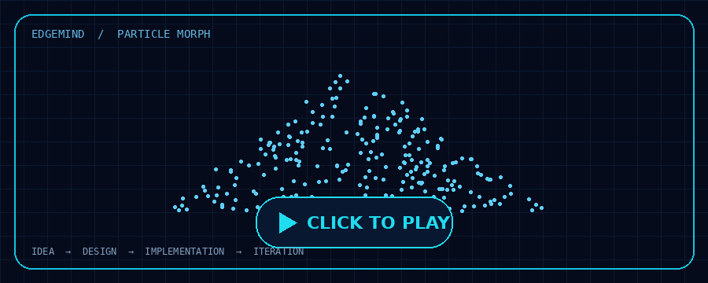

<!-- ====================================================== -->

<!-- NALLA RITHWIK | WHISKERWOLF                            -->

<!-- Dark Aurora | Cyan | Violet | Terminal Aesthetic       -->

<!-- ====================================================== -->

<picture>
  <source media="(prefers-color-scheme: dark)" srcset="./dark.svg">
  <source media="(prefers-color-scheme: light)" srcset="./light.svg">
  
</picture>

 

  

01 / IDENTITY.SIGNAL

<table>
<tr>
<td width="60%" valign="top">

> whoami

I'm Nalla Rithwik, a Computer Science student at SRM University AP.

I enjoy building practical software, exploring Artificial Intelligence, working with data, and understanding how reliable applications are designed and deployed.

Current interests

Artificial Intelligence & Machine Learning

Data Science & Analytics

Backend Engineering

Cloud & DevOps

Software Engineering

My approach

LEARN → BUILD → TEST → IMPROVE

</td>
<td width="40%" valign="top">

> operating.principles

SIGNAL

PRINCIPLE

01

🔹 LEARN

02

🟣 BUILD

03

🟢 ITERATE

04

🔹 SHIP

 

CURRENT STATUS

Building · Learning · Shipping

</td>
</tr>
</table>

02 / THE TOOLS BEHIND THE WORK

Technologies represented across completed projects, implementation work and current learning.

03 / BUILT, SHIPPED, SHARED

 

 

IDEA → DESIGN → IMPLEMENTATION → ITERATION

<table>
<tr>
<td width="50%" valign="top">

🧠 EdgeMind

AI-focused software engineering project.

Focus: AI · Software Engineering

</td>
<td width="50%" valign="top">

🌐 AI Network Packet Analyzer

Packet sniffing, protocol detection and anomaly detection using Isolation Forest.

Stack: Python · Scapy · Tkinter · ML

</td>
</tr>
<tr>
<td width="50%" valign="top">

⚙️ Smart CPU Scheduler Visualizer

Interactive CPU scheduling visualizer supporting FCFS, SJF, Priority and Round Robin, with Gantt charts and performance metrics.

Stack: Python · Tkinter · Matplotlib · Algorithms

</td>
<td width="50%" valign="top">

📊 Netflix Data Analysis

Exploratory analysis of Netflix content, including data cleaning, visualization and business insights.

Stack: Python · Pandas · NumPy · Matplotlib

</td>
</tr>
<tr>
<td width="50%" valign="top">

📰 AI Fake News Detector

NLP-based fake news classification using TF-IDF features and machine learning.

Stack: Python · NLP · TF-IDF · scikit-learn

</td>
<td width="50%" valign="top">

🔐 Token Cookie Project

JWT-based authentication and secure HTTP-only cookie handling.

Stack: Node.js · Express · JWT · Cookies

</td>
</tr>
</table>

04 / GITHUB.ANALYTICS

  

05 / CONTRIBUTION.TRAIL

06 / CURRENTLY.EXPLORING

<table>
<tr>
<td width="50%" valign="top">

01 / ARTIFICIAL INTELLIGENCE

Deep Learning

Neural Networks

Natural Language Processing

Machine Learning

</td>
<td width="50%" valign="top">

02 / DATA SCIENCE

Statistics

Data Analysis

Data Visualization

SQL

</td>
</tr>
<tr>
<td width="50%" valign="top">

03 / SOFTWARE ENGINEERING

Java & Python

Data Structures & Algorithms

Backend Engineering

API Security

</td>
<td width="50%" valign="top">

04 / CLOUD & DEVOPS

Linux & Ubuntu

Docker

AWS

Deployment & Automation

</td>
</tr>
</table>

07 / CONNECT

MAKE SOMETHING WORTH NOTICING

I enjoy collaborating with people who care about engineering quality, continuous learning and building useful products.

 

  

 

DESIGNED AROUND CURIOSITY · BUILT WITH PURPOSE · ALWAYS EVOLVING

  

© Nalla Rithwik · WHISKERWOLF

