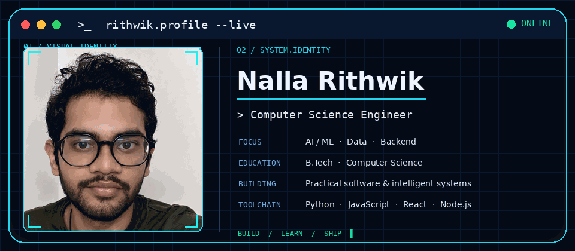

 

**COMPUTER SCIENCE ENGINEER · FULL-STACK DEVELOPER · AI/ML ENTHUSIAST**

*Building practical software, intelligent systems, and data-driven applications.*

---

## 01 / Identity

<table>
<tr>
<td width="62%" valign="top">

### `whoami`

I'm **Nalla Rithwik**, a Computer Science student at **SRM University AP**.

I enjoy turning ideas into working software, exploring AI and machine learning, building backend systems, and understanding how applications are designed, secured, and deployed.

- **Focus:** Full-stack development, AI/ML, data science and backend engineering
- **Approach:** Learn deeply · Build consistently · Improve through feedback
- **Currently exploring:** Cloud, DevOps, Docker, AWS and applied machine learning

</td>
<td width="38%" valign="top">

### `operating.principles`

| # | Principle |
|:--:|:--|
| 01 | 🔹 **LEARN** |
| 02 | 🟣 **BUILD** |
| 03 | 🟢 **ITERATE** |

</td>
</tr>
</table>

---

## 02 / The tools behind the work

*The stack reflects technologies used across projects and current learning—not a claim of equal expertise in every tool.*

---

## 03 / Selected projects

<table>
<tr>
<td width="50%" valign="top">

### 🧠 [EdgeMind](https://github.com/whiskerwolf/EdgeMind)

AI-focused software engineering project.

`AI` `Software Engineering`

[**Explore repository →**](https://github.com/whiskerwolf/EdgeMind)

</td>
<td width="50%" valign="top">

### 🌐 [AI Network Packet Analyzer](https://github.com/whiskerwolf/AI-Network-Packet-Analyzer)

Packet sniffing, protocol detection and anomaly detection using Isolation Forest.

`Python` `Scapy` `Tkinter` `ML`

[**Explore repository →**](https://github.com/whiskerwolf/AI-Network-Packet-Analyzer)

</td>
</tr>
<tr>
<td width="50%" valign="top">

### ⚙️ [Smart CPU Scheduler Visualizer](https://github.com/whiskerwolf/smart-cpu-scheduler-visualizer)

Interactive FCFS, SJF, Priority and Round Robin scheduling with Gantt charts and performance metrics.

`Python` `Tkinter` `Algorithms`

[**Explore repository →**](https://github.com/whiskerwolf/smart-cpu-scheduler-visualizer)

</td>
<td width="50%" valign="top">

### 📊 [Netflix Data Analysis](https://github.com/whiskerwolf/Netflix-Data-Analysis)

Exploratory analysis and visualization of Netflix titles, using data cleaning and statistical summaries.

`Python` `Pandas` `NumPy` `Matplotlib`

[**Explore repository →**](https://github.com/whiskerwolf/Netflix-Data-Analysis)

</td>
</tr>
<tr>
<td width="50%" valign="top">

### 📰 AI Fake News Detector

NLP-based fake-news classification using TF-IDF and machine learning.

`Python` `NLP` `Scikit-learn`

</td>
<td width="50%" valign="top">

### 🔐 Token Cookie Project

Authentication implementation with JWT and secure HTTP-only cookie handling.

`Node.js` `Express` `JWT`

</td>
</tr>
</table>

---

## 04 / Engineering activity

&nbsp;

  

---

## 05 / Contribution trail

---

## 06 / Currently exploring

`Machine Learning` · `Neural Networks` · `NLP` · `Data Science`  
`Statistics` · `SQL` · `DSA` · `Java`  
`Linux` · `Docker` · `AWS` · `DevOps`

---

## 07 / Connect

I'm interested in thoughtful collaboration, practical engineering, and building useful products.

 

**DESIGNED WITH CURIOSITY · BUILT WITH PURPOSE**

